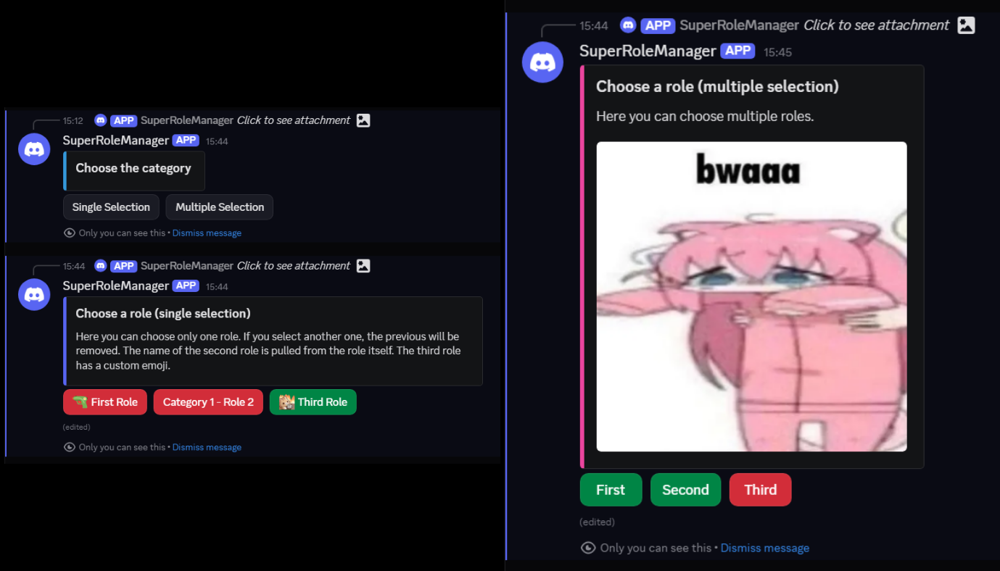

# SuperRoleManager

[](https://wakatime.com/badge/user/4c9e13d6-f2cb-49e8-a798-6f2ee2f1963f/project/3ea92694-e90e-4976-8766-20accd08f706)


A config-driven Discord role manager with state-aware UI and hot-reload configuration built on Pycord. Use modern buttons instead of reactions!


## Why?

Most self-role bots start simple but turn into a mess at scale. Discord's built-in role customization is not customizable and requires enabling community features. "Reaction role" bots feel outdated, hacky, and locked around reactions api limitations. Plus, having all categories in one channel sometimes turns into wall of text.

SuperRoleManager takes a different approach. It provides clean and comfortable config to manage all your role categories and options in one place. Then, it renders a dynamic menu where user can choose which specific role category they are interested in, and then pick from there. The buttons are state-aware, so they always show the real role state of the user. The service layer enforces all the rules, so you can have single-select categories without worrying about edge cases. Finally, any config change is hot-reloaded without needing to restart the bot.

Smooth for users and stays maintainable for admins! Win-win!

## Key Features

- Role policy lives entirely in `config/roles.yaml`
- Buttons always show real role state (added/removed live)
- Proper single-select and multi-select handling in one place
- Automatically skips unavailable or missing roles
- Hot-reload: edit the YAML and changes apply immediately



## Architecture

```
main.py                  # Bot startup + persistent views + watcher
cogs/role_menu.py        # Admin command to post the menu
services/role_service.py # All the actual logic and rules
views/                   # Dynamic menus and button handling
models/                  # Typed config structures
utils/                   # Config loading and hot-reload
```

I kept the UI thin and put the real policy in the service layer. This makes the code predictable and easy to extend.

## Example Config Snippet

```yaml
categories:
  - id: games
    name: Games
    multi_select: false
    embed:
      title: Choose your game
      description: Only one at a time.
      color: 0x5865F2
    roles:
      - id: 1234567890123456789
        name: CS2
        emoji: "🔫"
```

Supports unicode emojis, custom emoji IDs, role icons, or `-1` for none.
See [roles.example.yaml](config/roles.example.yaml) for a full example — copy it to `config/roles.yaml` (gitignored) and edit it for your server.

## Tech Stack

- Python 3.14+
- [Pycord](https://pycord.dev/) with persistent views
- [Loguru](https://github.com/Delgan/loguru) for logging (I hate the standard logging module)
- PyYAML, python-dotenv

## Getting Started

1. Clone the repo
2. Add your `BOT_TOKEN` to `.env`
3. Copy `config/roles.example.yaml` to `config/roles.yaml` and edit it for your server
4. Run the bot
5. Use `role!setup` in a channel to publish the menu (the code is in `cogs/role_menu.py` if you want to customize it)

Feel free to try it or fork it for your server.

> **Note:** This bot was developed 2-3 months ago. The latest commit (2026-10-27) is just a small polish pass, not new feature work - but I am ready to keep the work on this repository if it will get any notice.
